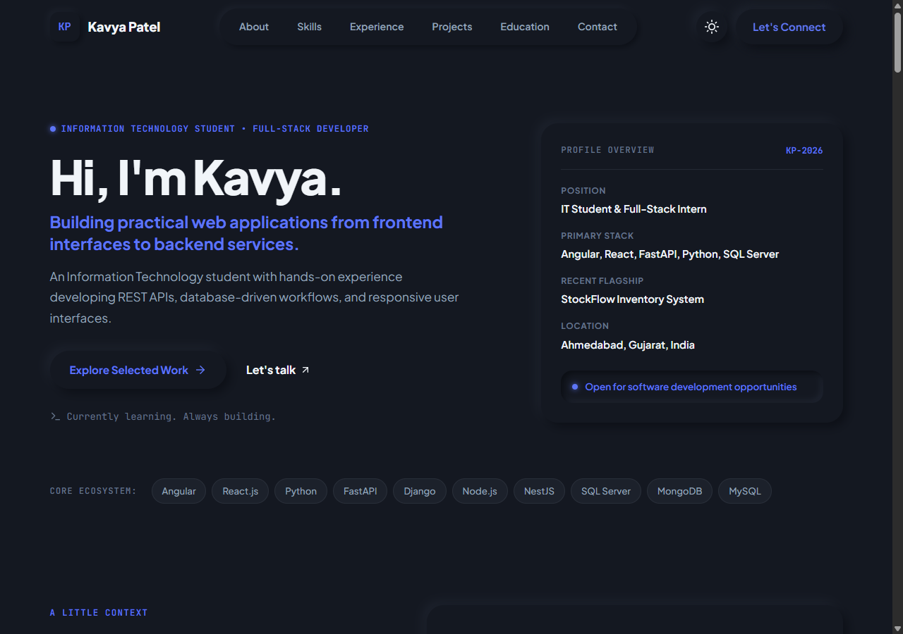

# Kavya Patel — Developer Portfolio



> **Live Demo:** [https://kavyapatel2711-beep.github.io/Patel_kavya_2601542027_Portfolio/](https://kavyapatel2711-beep.github.io/Patel_kavya_2601542027_Portfolio/)  
> **Repository:** [https://github.com/kavyapatel2711-beep/Patel_kavya_2601542027_Portfolio](https://github.com/kavyapatel2711-beep/Patel_kavya_2601542027_Portfolio)

---

## 📌 Project Overview

This repository contains the personal developer portfolio website for **Kavya Patel** (Roll No: **2601542027**), an Information Technology student and aspiring full-stack developer.

The portfolio is designed with a modern, tactile neumorphic aesthetic, presenting an end-to-end overview of technical skills, academic background, industry internships, and featured projects. It highlights practical software engineering capabilities across frontend interfaces, backend APIs, and database-driven applications.

---

## 🚀 Key Features

- **Responsive Neumorphic Design:** Soft shadow elevation, clean contrast, and fluid responsiveness across desktop, tablet, and mobile devices.
- **Light & Dark Theme Toggle:** Instant theme switcher with smooth transitions and persistent state stored in `localStorage`.
- **Interactive Navigation:** Sticky header, active section indicator, smooth anchor scrolling, and an accessible mobile drawer menu.
- **Project Showcase:** Filterable and detailed cards highlighting real-world projects such as *StockFlow* and *Digital Ordering System*, with architecture details and tech stacks.
- **Experience & Education Timelines:** Structured timelines detailing internships, responsibilities, key achievements, and academic credentials.
- **Interactive Contact Form & Utilities:** Clean contact interface with client-side form validation, one-click email copying to clipboard, and verified social/career links.

---

## 🛠️ Technologies Used

### Frontend & Core Technologies
- **HTML5:** Semantic markup, accessibility attributes (`aria-*`), and Open Graph metadata.
- **CSS3:** Custom properties (CSS variables), CSS Grid, Flexbox, Neumorphism design system, media queries, and dark mode theming.
- **JavaScript (ES6+):** Vanilla JavaScript for theme switching, mobile drawer toggle, scroll tracking, and client-side form validation.

### Design & Typography
- **Typography:** *Plus Jakarta Sans* (modern geometric sans-serif) & *JetBrains Mono* (code/monospace accents).
- **Icons:** Lightweight, inline SVGs for fast loading and crisp scaling.

---

## 📂 Project Structure

```text
Patel_kavya_2601542027_Portfolio/
├── index.html         # Main semantic HTML structure and sections
├── style.css          # CSS tokens, neumorphic styling, responsive layout, dark theme
├── script.js          # Interactive features (theme toggle, mobile menu, navigation, copy, form)
├── portfoliodata.md   # Project specification and data reference
├── screenshot.png     # Portfolio preview screenshot for README
└── README.md          # Project documentation, live link, and setup instructions
```

---

## 💻 Getting Started Locally

1. **Clone the repository:**
   ```bash
   git clone https://github.com/kavyapatel2711-beep/Patel_kavya_2601542027_Portfolio.git
   ```

2. **Navigate to the project folder:**
   ```bash
   cd Patel_kavya_2601542027_Portfolio
   ```

3. **Open `index.html` in your web browser:**
   - Double-click `index.html`, or
   - Use VS Code Live Server extension to preview locally at `http://localhost:5500`.

---

## 🌐 Deployment (GitHub Pages)

This portfolio is configured for deployment using **GitHub Pages**:
1. In the repository settings on GitHub, navigate to **Pages**.
2. Under **Build and deployment > Source**, select `Deploy from a branch`.
3. Set the branch to `main` and folder to `/ (root)`.
4. Click **Save**. The site will be live at:
   `https://kavyapatel2711-beep.github.io/Patel_kavya_2601542027_Portfolio/`

---

## 👤 Author

- **Name:** Kavya Patel
- **Roll No:** 2601542027
- **GitHub:** [@kavyapatel2711-beep](https://github.com/kavyapatel2711-beep)
- **Role:** Information Technology Student & Full-Stack Developer
